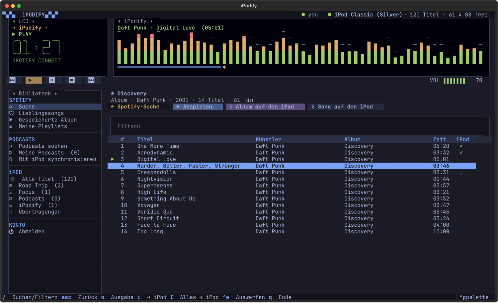

# iPodify

A retro, Winamp-flavoured music box for your terminal that puts Spotify songs, albums, playlists and
podcasts onto a classic iPod. Built for [Omarchy](https://omarchy.org) and colored by your Omarchy theme.



Browse and play Spotify in a little LCD/spectrum-analyzer deck. Push a song, an album or a whole
playlist to the iPod with one key. iPodify then fetches the audio with [spotDL](https://github.com/spotDL/spotify-downloader)
and writes it into the iPod's own database with [libgpod](https://sourceforge.net/projects/gtkpod/),
cover art included. Podcasts sync to the iPod's real Podcasts menu, and you can manage what's on the
iPod (tags, playlists, deleting) without iTunes.

> The interface is in German. Code, comments and docs are English.

## Features

- **Spotify, directly.** Log in with your own Spotify app. You get search (songs, albums, artists,
  playlists, or paste a Spotify link), Liked Songs, saved albums and your playlists. Playback runs
  through Spotify's official **Web Playback SDK** in an invisible headless Chromium, so iPodify shows up
  as a Spotify Connect device called "iPodify". It uses about 0.1 % of a CPU core when idle and about
  6 % while playing, no Spotify desktop app needed. Switch output to your phone, speakers or any other
  Connect device from the LCD (`o`).
- **A real spectrum analyzer.** The FFT runs on whatever is actually audible (PipeWire monitor), or on
  iPodify's own audio path for iPod files and podcasts. Peaks hold and fall like Winamp's.
- **Everything to the iPod.** `i` sends the selected song, album or playlist. `I` sends everything in
  the current view. Tracks already on the iPod are marked ✓ and skipped. Downloads run in batches, and
  each batch goes into the iTunesDB in a single write, into an "iPodify" playlist. spotDL looks on
  YouTube Music, YouTube, SoundCloud and Bandcamp, in that order.
- **Know what's missing before you start.** *Verfügbarkeit prüfen* asks spotDL for a source for every
  track of an album or playlist without downloading anything; the *Web* column shows ✓ or ✗. Sending an
  album to the iPod runs that check first and tells you which titles no source has, so an audiobook
  does not end up with chapters missing.
- **Record what nobody has.** Tracks that exist only on Spotify can be captured from the Web Playback
  SDK player in real time (*mitschneiden*): the headless Chromium is restarted with its audio routed
  into a private PipeWire null sink, so nothing reaches the speakers, and the capture is encoded with
  tags and cover art and transferred like any other download. One album chapter takes as long as it
  plays. This is a last resort and against Spotify's terms of service; it's your call.
- **Podcasts.** Search the Apple Podcasts directory, subscribe, listen in the app. *Sync* puts the
  newest 1/3/5/10 episodes of each subscription into the iPod's Podcasts menu (unplayed bullet,
  remembered position, artwork, show notes). It removes older episodes that iPodify put there itself and
  never touches anything synced by iTunes/Finder.
- **iPod management.** Play songs straight off the iPod, mark (`m`), edit tags (`e`), delete (`d`),
  build and rename playlists (`p`, `n`, `R`, `D`), filter (`/`), sort by clicking column headers.
- **Careful with your iPod.** Every write backs up the iTunesDB first. The iPod is mounted read-write
  only while writing, so its HFS+ volume is flagged clean again as soon as possible. Eject with `Ctrl+E`.
- **Themed.** Colors come live from the current Omarchy theme (`~/.local/state/omarchy/current/theme/colors.toml`),
  and a theme switch restyles the running app.
- **Tidy.** Background helpers (headless Chromium, audio recorder, librespot) are reaped by a watchdog
  when iPodify exits, even on a crash or a closed terminal.

## Requirements

- Arch Linux / Omarchy with PipeWire (`pipewire-pulse` for `pacat`/`parec`).
- **Spotify Premium** (Spotify requires it for any third-party playback) and a free
  [Spotify developer app](https://developer.spotify.com/dashboard).
- Chromium with the Widevine CDM. Arch's `chromium` downloads it on first use. iPodify copies just that
  module into its own private browser profile.
- An iPod with an iTunesDB that libgpod supports. Tested with an **iPod Classic 80 GB (6th gen)**;
  other click-wheel iPods supported by libgpod should work. iPod nano 6G/7G and iOS devices won't.

## Install

```bash
git clone https://github.com/ibornholz/ipodify.git
cd ipodify
./setup.sh
```

`setup.sh` asks for sudo and does the following:

- installs `libgpod ffmpeg chromium pipewire-pulse librespot` (pacman) and `hfsprogs` (AUR, via `yay`),
- creates a Python venv with the pinned dependencies,
- builds `bin/ipod-helper`,
- adds an *iPodify* entry to the app launcher,
- if a connected iPod's filesystem is flagged as not cleanly unmounted, repairs it with `fsck.hfsplus`.

Start iPodify from the launcher or with `./ipodify.sh`.

### First run: your Spotify app

On first start iPodify asks for a Spotify app. It takes two minutes:

1. Open <https://developer.spotify.com/dashboard> → **Create app**.
2. Redirect URI: `http://127.0.0.1:8898/callback`. APIs: tick **Web API** and **Web Playback SDK**.
3. Copy **Client ID** and **Client Secret** from *Settings* into the dialog, then confirm the login in
   your browser.

The credentials and the login token are stored in `~/.config/ipodify/` (mode 600), never in the
project directory. spotDL uses the same app, so it doesn't share spotDL's public, often rate-limited
default credentials.

Spotify development-mode apps have some limits: at most 10 search results per category, no artist
top tracks, and only playlists you own or collaborate on can be opened.

## Keys

| Key | |
|---|---|
| `/` | Search (Spotify / podcasts) or filter the list |
| `⏎` | Play a song or episode · open an album, playlist, artist or podcast |
| `Esc` `⌫` | Back (also the "←" button) |
| `z` `x` `c` `v` `b` | Previous · play · pause · stop · next (Winamp style), `Space` = play/pause |
| `,` `.` · `+` `-` | ±10 s · volume (seek bar and VOL are clickable too) |
| `o` | Choose the playback device |
| `i` / `I` | Selection / whole view to the iPod |
| `m` · `Ctrl+A` | iPod: mark · mark all |
| `e` · `d` · `p` · `r` | iPod: edit tags · delete · add to playlist · remove from playlist |
| `n` · `R` · `D` | New playlist · rename · delete playlist |
| `Ctrl+E` | Eject the iPod |
| `L` · `q` | Spotify login · quit |

## Configuration

Optional `~/.config/ipodify/config.toml` (the setup dialog writes the first two keys):

```toml
client_id = "…"
client_secret = "…"
player = "sdk"                     # "sdk" (default) · "app" (remote-control the Spotify desktop app) · "librespot"
spotify_device = ""                # preferred Connect device; set by the output menu
playlist = "iPodify"               # iPod playlist that receives new songs
format = "mp3"                     # spotDL output: "mp3" or "m4a"
audio = ["youtube-music", "youtube", "soundcloud", "bandcamp"]  # spotDL sources, tried in this order
volume = 70
cookies_from_browser = "chromium"  # lets spotDL/yt-dlp use your YouTube cookies against bot checks
```

Other files: podcast subscriptions in `~/.config/ipodify/podcasts.json`; downloads in
`~/.cache/ipodify/{tracks,podcasts}/`; iTunesDB backups (last 30) in `~/.local/share/ipodify/backup/`.

## Troubleshooting

- **The iPod stays read-only / "Dateisystem muss geprüft werden".** Linux refuses to write to an HFS+
  volume that is flagged as not cleanly unmounted, for example after a USB hiccup. Run `./setup.sh` to
  repair it with `fsck.hfsplus`. If you also use the iPod with a Mac, disabling the journal there once
  (`diskutil disableJournal /Volumes/<iPod>`) is the cleanest setup for Linux.
- **Transfers fail with "YouTube-Bot-Sperre".** YouTube is asking spotDL to prove it's not a bot. Set
  `cookies_from_browser` (see above) or try again later.
- **"kein passender YouTube-Treffer".** The track is not on any of spotDL's sources. Use *⏺ mitschneiden*
  in the transfers view (or the album view) to record it from the Spotify player instead.
- **A recording came out too short or silent.** The capture needs `player = "sdk"` and the PipeWire
  PulseAudio shim (`pactl`, `parec`). While recording, the Spotify player is muted on purpose; the
  recorded track should show up in the LCD as playing.
- **No sound with `player = "librespot"`.** Spotify currently refuses librespot's audio keys for many
  accounts ([librespot#1649](https://github.com/librespot-org/librespot/issues/1649)). That's why the
  default player is the Web Playback SDK.
- **The web player never becomes ready.** Make sure Chromium has its Widevine CDM: open Chromium once,
  play any Spotify/Netflix web content, then restart iPodify.
- **Songs vanished after syncing with a Mac.** Finder/Music may replace the iPod's library with the
  Mac's. Either manage the iPod from one side only, or enable manual management on the Mac.

## Development

```sh
.venv/bin/pip install -r requirements-dev.txt
.venv/bin/pytest
```

The tests run against a throw-away XDG tree and a fake `spotdl`, so they never touch your config,
cache, iPod or the network. They cover the iPod read/write strategy, the transfer queue, the
availability cache, the recorder's session and state handling, podcast feeds, Spotify search paging
and the audio engine's suspend/resume. The Textual UI itself is not driven by tests.

## How it works

See [docs/architecture.md](docs/architecture.md) for the moving parts: Spotify Web API and the headless
SDK player, the audio and analyzer paths, the libgpod helper protocol and the iPod write strategy.

## Legal

iPodify is a personal hobby project and is not affiliated with Apple or Spotify. "iPod" and "Spotify"
are trademarks of their respective owners. spotDL downloads audio from YouTube and other public sources.
Only download content you are allowed to download in your country. iPodify does not circumvent Spotify's
DRM and does not download Spotify audiobooks. The optional recording feature captures the audio the
Spotify player outputs on this machine, for private use on your own iPod; it violates Spotify's terms of
service and may be illegal where you live. Use it on your own responsibility.

## License

[MIT](LICENSE)
